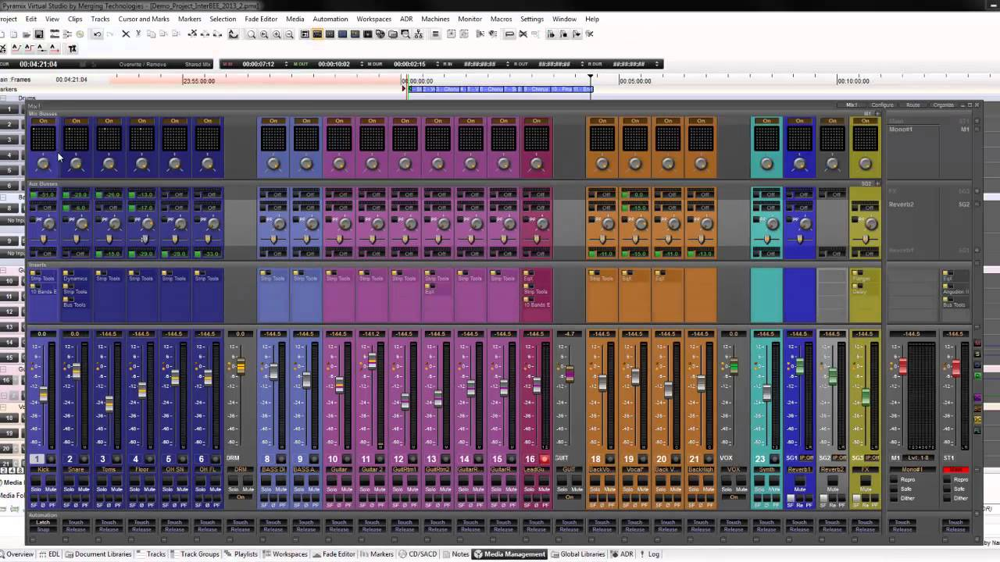
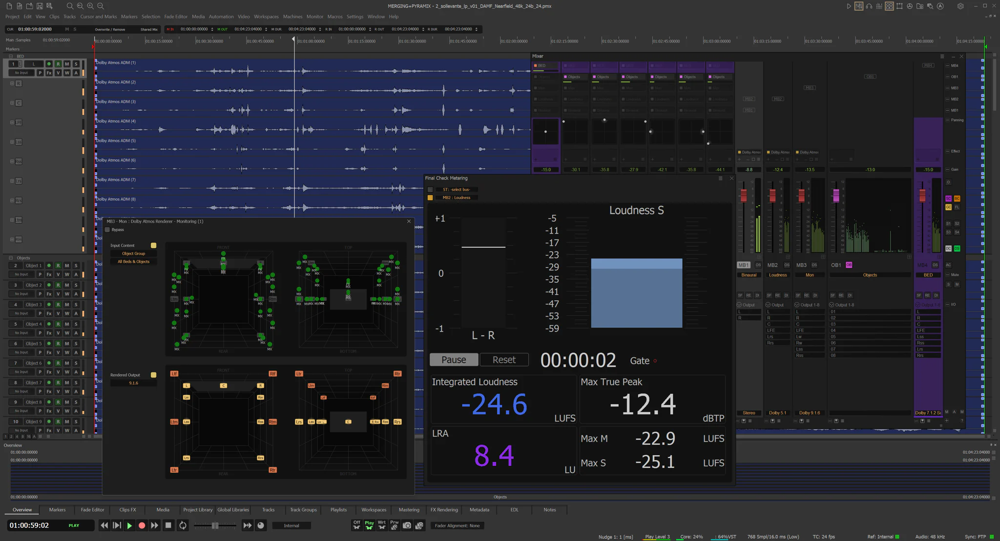

# Pyramix Builds Finished Masters From Multitrack Recording Sessions

A concert recording can contain many convincing takes without a finished performance.
Merging Pyramix brings recording, detailed editing, mixing, and mastering into one Windows DAW, with Source-Destination editing for assembling selections from multitrack sessions.
Follow the musical decisions through to the deliverable: which take was chosen, how the transition sounds, and which master contains the approved edit.

[](https://merging-pyramix.github.io/Pyramix-DAW/)

## Assemble the performance before polishing the mix

Use Source-Destination editing to compare material and build a destination sequence from selected passages.
Keep ensemble microphones aligned when choosing or replacing a passage.
Audition a transition with enough context to hear the phrasing, room decay, and movement into the next section.
Pyramix's crossfade editor supports asymmetric transitions when the incoming and outgoing material need different treatment.

1. Identify the preferred passage using take notes and musical landmarks.
2. Make the selection across the relevant microphone tracks.
3. Listen through the edit in the destination sequence.
4. Revisit the fade after level or processing changes.

The [official product overview](https://www.neumann.com/en-us/products/software/pyramix-pro-pack) describes Source-Destination editing, take logging, and crossfade tools.
Keep a separate editorial decision list when producer feedback must be reconciled across versions.

This Python example prints a small CSV review log using the standard library:

```python
import csv
import sys

log = csv.writer(sys.stdout)
log.writerow(["movement", "take", "source_in_seconds", "source_out_seconds", "decision"])
log.writerow(["I", "take_07", 42.5, 68.0, "approved"])
log.writerow(["I", "take_11", 68.0, 91.2, "compare room decay"])
```

The fields are an independent review convention, not a Pyramix import format.
Python's [CSV documentation](https://docs.python.org/3/library/csv.html) explains the writer interface.
Use actual source positions and consistent time units when replacing these illustrative entries.



For an implementation comparison, [TimelineTest.cpp](tests/src/core/TimelineTest.cpp) tests position changes and elapsed-time behavior.
The project fixture [emptyproject.mmp](tests/emptyproject.mmp) demonstrates an XML-based session document.
Neither reference encodes the editorial decisions printed above.

## Keep acquisition format separate from delivery format

Pyramix DAW supports PCM, DXD, and DSD workflows, with capabilities depending on the selected pack and audio engine.
Confirm the recording format and interface configuration before a session.
Choose the archive and delivery formats independently so a client's requested file does not dictate every earlier production decision.

For classical music, take notes should preserve movement names, take numbers, and comments that remain useful during editing.
A second recording destination can provide immediate redundancy, while an archive still needs a deliberate retention plan.
Confirm both destinations contain usable media before releasing the recording setup.

The [Pyramix reference manual](https://merging.com/uploads/assets/Installers/LABET/Pyramix_15.0.7_HotFix1/Pyramix_15_User_Manual_v07.pdf) documents the version 15 interface and workflows.
Check the documentation supplied with your installed version when following menu-level instructions.
Avoid treating sample-rate support as a promise that every plugin or external device supports the same operating mode.

Useful comparison references address three different parts of session reliability:

- [AudioBufferTest.cpp](tests/src/core/AudioBufferTest.cpp) exercises channel groups, silence tracking, and buffer behavior.
- [RelativePathsTest.cpp](tests/src/core/RelativePathsTest.cpp) checks path conversions and comparisons.
- [ProjectVersionTest.cpp](tests/src/core/ProjectVersionTest.cpp) checks comparisons between project-version values.

The dependency manifest [vcpkg.json](vcpkg.json) names libraries used by the companion codebase, including audio-related dependencies.
A dependency list alone does not establish which formats a particular application build can open.

## Balance microphones, then evaluate automation in context

When combining main and spot microphones, listen to phase relationships as well as level.
Pyramix includes PanNoir tools for phase alignment and spatial control in this type of setup.
Compare changes across the ensemble image and through edits, rather than judging a spot microphone in isolation.

Dynamic automation and snapshots support different kinds of mix decisions.
Use a snapshot for a reproducible state and continuous automation where a parameter needs to follow the performance.
Review automation after moving or replacing material so an older change does not work against the new passage.

The tests provide several focused examples of how another audio application checks parameter behavior.
[AutomationTrackTest.cpp](tests/src/tracks/AutomationTrackTest.cpp) covers automation clips, their lengths, and different playback contexts.
[AutomatableModelTest.cpp](tests/src/core/AutomatableModelTest.cpp) exercises model linking, changes, and value conversions.
At a lower level, [ArrayVectorTest.cpp](tests/src/core/ArrayVectorTest.cpp) tests container behavior.
[MathTest.cpp](tests/src/core/MathTest.cpp) checks a numerical utility for counting digits.



## Define the master by its intended destination

An album master, a review copy, and an immersive exchange file have different acceptance criteria.
Write those criteria before the final export, including channel layout, format, metadata, and revision.
For a Pyramix Pro project, verify the installed pack against the actual delivery specification.

| Intended output | Information to settle | Listening or technical review | Keep with the output |
| --- | --- | --- | --- |
| Stereo PCM master | Rate, word length, naming | Starts, tails, edits, channel order | Approved revision |
| Album authoring package | Track order, markers, metadata | Transitions and release sequence | Authoring notes |
| Client review copy | Playback format and identifying labels | Correct edit and intended balance | Feedback reference |
| Dolby Atmos exchange | ADM requirements and renderer workflow | Object assignment and monitoring | Delivery specification |

The [Premium pack description](https://www.neumann.com/en-us/products/software/pyramix-premium-pack) identifies Dolby Atmos rendering and ADM exchange capabilities.
Pyramix also provides album publishing, DDP authoring, and loudness tools.
Check the selected pack and version before committing to a specific immersive handoff.

For an independent loudness review of an exported PCM file, use FFmpeg's EBU R128 scanner:

```powershell
ffmpeg -hide_banner -nostats -i "approved-stereo.wav" -map 0:a:0 -af "ebur128=peak=true" -f null -
```

The [EBU R128 filter reference](https://ffmpeg.org/ffmpeg-filters.html#ebur128) describes integrated loudness, loudness range, and peak analysis.
Read the final summary and compare it with the recipient's specification.
This command analyzes the selected audio stream without writing a replacement master.

For a requested 48 kHz, 24-bit PCM copy, FFmpeg can resample a floating-point stereo export:

```powershell
ffmpeg -n -i "approved-float.wav" -map 0:a:0 -af "aresample=48000:dither_method=triangular:output_sample_bits=24" -c:a pcm_s24le "delivery-48k-24bit.wav"
```

The [resampler options](https://ffmpeg.org/ffmpeg-resampler.html) define triangular dithering and the output precision setting.
Keep the original export and avoid applying another dither stage to an already finalized integer master.
The example retains the input channel layout; it does not create a stereo downmix or an Atmos deliverable.

The command reference [lmms.1](doc/lmms.1) documents a separate project's rendering and export options.
Its shell completion file [lmms](doc/bash-completion/lmms) maps command options for interactive use.
The fixture manifest [README](tests/README) records an expected checksum for an empty-project render.

## Make session knowledge readable beyond the edit room

A Pyramix handoff benefits from clear take notes, delivery requirements, and an identified final revision.
When archiving a Pyramix Virtual Studio session, preserve the source recordings and enough context to understand the approved sequence.
Record plugins or external processing that another workstation would need to recreate the mix.

For maintaining readable companion documentation, the supplied references cover presentation and consistency:

| Reference | Purpose in the supplied materials |
| --- | --- |
| [Doxyfile.in](doc/Doxyfile.in) | Defines source-documentation extraction settings |
| [extra.css](doc/extra.css) | Styles generated documentation |
| [CMakeLists.txt](doc/CMakeLists.txt) | Configures the documentation generation target |
| [README.md](tests/scripted/README.md) | Explains scripted source checks |
| [check-strings](tests/scripted/check-strings) | Looks for stale path and class-name strings outside source code |
| [check-namespace](tests/scripted/check-namespace) | Checks namespace-related source conventions |

The build notes [INSTALL.txt](INSTALL.txt) describe dependencies and submodules needed for a complete build.

## Related Search Terms

Merging Pyramix, Pyramix DAW, merging technologies pyramix, pyramix pro, pyramix virtual studio, audio, daw, music-production, audio-editing, multitrack-recording, mastering, immersive-audio, dsd, dxd, post-production
